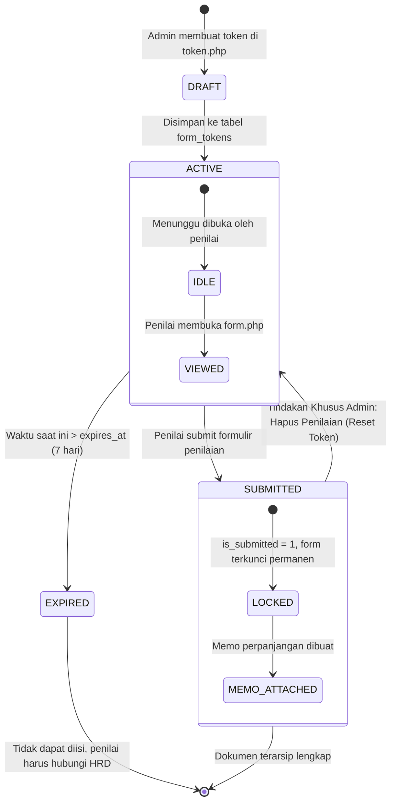
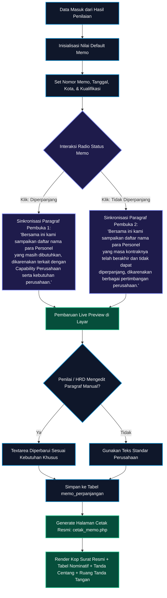
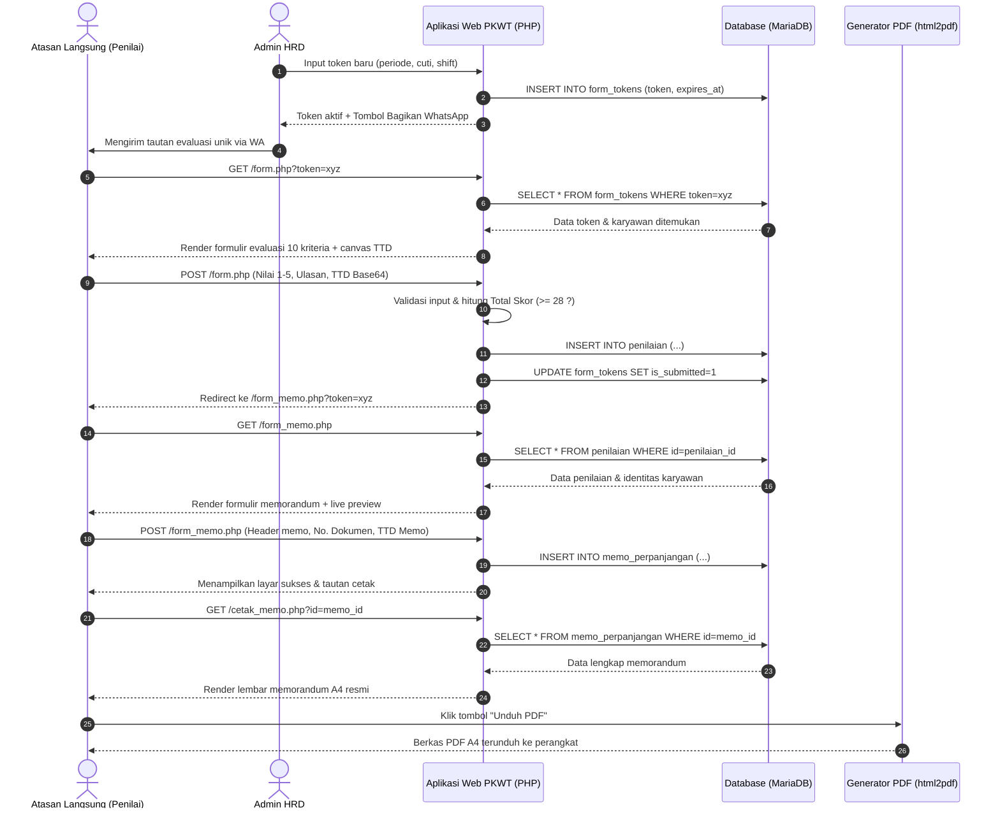
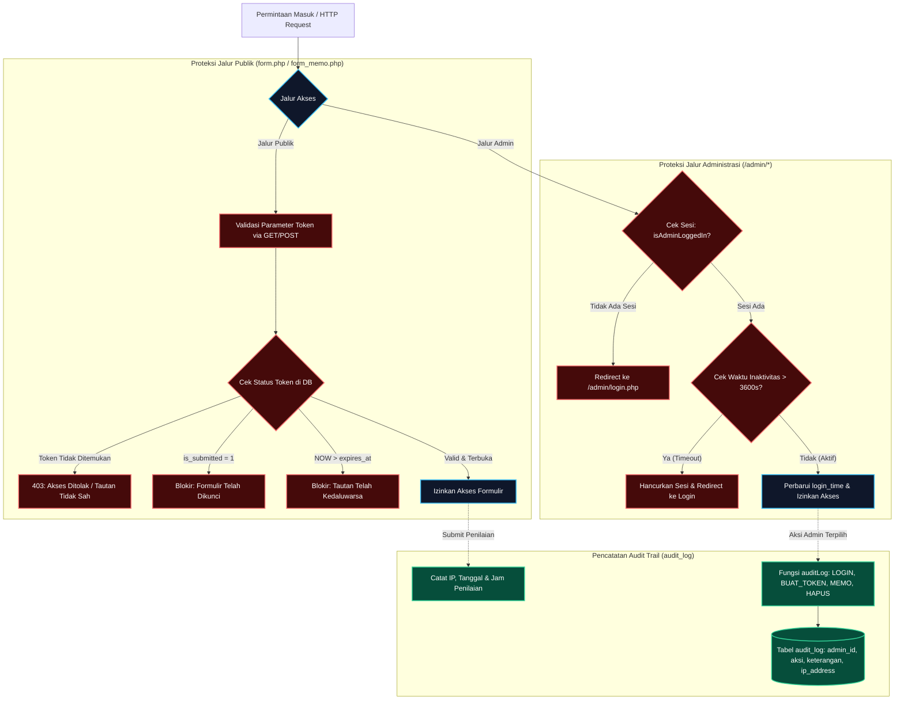

# Alur & Diagram Sistem PKWT (Process Flow & Architecture)
### PT Indopelita Aircraft Industries

Dokumen ini mendokumentasikan secara menyeluruh alur kerja (*business workflow*), siklus hidup data (*state lifecycle*), algoritma kalkulasi skor, serta diagram sekuensial interaksi pada **Sistem Penilaian Kinerja Karyawan PKWT dan Penerbitan Dokumen Memorandum**.

---

## 📑 Daftar Isi Diagram

1. [Alur Bisnis End-to-End (Overall Workflow)](#1-alur-bisnis-end-to-end-overall-workflow)
2. [Siklus Hidup Token Evaluasi (Token State Machine)](#2-siklus-hidup-token-evaluasi-token-state-machine)
3. [Mesin Kalkulasi Skor & Logika Keputusan (Scoring Engine)](#3-mesin-kalkulasi-skor--logika-keputusan-scoring-engine)
4. [Alur Penyusunan & Sinkronisasi Dokumen Memorandum](#4-alur-penyusunan--sinkronisasi-dokumen-memorandum)
5. [Sequence Diagram Interaksi Pengguna & Sistem](#5-sequence-diagram-interaksi-pengguna--sistem)
6. [Arsitektur Keamanan, Akses, & Audit Trail](#6-arsitektur-keamanan-akses--audit-trail)
7. [Matriks Relasi & Integritas Status Data](#7-matriks-relasi--integritas-status-data)

---

## 1. Alur Bisnis End-to-End (Overall Workflow)

Diagram berikut menggambarkan perjalanan data mulai dari pendaftaran karyawan oleh HRD, penerbitan token, pengisian form penilaian oleh atasan langsung, kalkulasi kelayakan perpanjangan, hingga terbitnya dokumen memorandum resmi.

```mermaid
flowchart TD
    classDef hrd fill:#0f172a,stroke:#38bdf8,stroke-width:2px,color:#fff;
    classDef atasan fill:#064e3b,stroke:#34d399,stroke-width:2px,color:#fff;
    classDef system fill:#1e1b4b,stroke:#818cf8,stroke-width:2px,color:#fff;
    classDef decision fill:#701a75,stroke:#f472b6,stroke-width:2px,color:#fff;
    classDef doc fill:#14532d,stroke:#4ade80,stroke-width:2px,color:#fff;

    subgraph HRD_Flow["1. Divisi Human Capital / Admin HRD"]
        A[Input / Import Data Karyawan]:::hrd --> B[Buka Menu Token Penilaian]:::hrd
        B --> C[Generate Token Baru<br/>Pilih Karyawan & Periode]:::hrd
        C --> D[Kirim Tautan Unik via WhatsApp / Chat]:::hrd
    end

    subgraph Evaluation_Flow["2. Atasan Langsung (Penilai)"]
        D -.->|Membuka Tautan Unik| E[Akses Halaman form.php?token=xyz]:::atasan
        E --> F{Validasi Token Sistem}:::decision
        F -- Valid & Aktif --> G[Isi 10 Kriteria Penilaian<br/>Skala 1 - 5]:::atasan
        F -- Expired / Tidak Valid --> H[Tampilkan Halaman Blokir / Kadaluarsa]:::system
        F -- Sudah Pernah Diisi --> I[Tampilkan Halaman Penilaian Telah Selesai]:::system

        G --> J[Isi Ulasan Kualitatif, Pelatihan & Jobdesk]:::atasan
        J --> K[Bubuhkan Tanda Tangan Digital pada Canvas]:::atasan
        K --> L[Klik: Kirim Penilaian Kinerja]:::atasan
    end

    subgraph Scoring_Flow["3. Pemrosesan & Kalkulasi Otomatis"]
        L --> M[Kalkulasi Total Skor = sum(10 Kriteria)]:::system
        M --> N{Apakah Skor >= 28?}:::decision
        N -- Ya (>= 28) --> O[Status: DIPERPANJANG]:::system
        N -- Tidak (< 28) --> P[Status: TIDAK DIPERPANJANG]:::system
        O --> Q[Simpan Penilaian ke Database & Kunci Token]:::system
        P --> Q
        Q --> R[Redirect Otomatis ke form_memo.php]:::system
    end

    subgraph Memo_Flow["4. Penyusunan Memorandum Perpanjangan"]
        R --> S{Pilihan Tindakan Memo}:::decision
        S -- Langsung Dibuat --> T[Lengkapi Header & No. Dokumen Memo]:::atasan
        S -- Dilewati / Tunda --> U[Klik: Lewati Pengisian Memo]:::atasan
        U --> V[Akses Selesai (Memo Dibuat Nanti oleh HRD)]:::system

        T --> W[Verifikasi Status & Teks Sinkronisasi Otomatis]:::atasan
        W --> X[Cek Live Preview Dokumen Memorandum]:::atasan
        X --> Y[Klik: Terbitkan & Simpan Memorandum]:::atasan
    end

    subgraph Final_Flow["5. Output & Pengarsipan Resmi"]
        Y --> Z[Buka cetak_memo.php]:::doc
        Z --> AA[Unduh Berkas PDF atau Cetak Lembar A4 Fisik]:::doc
        AA --> AB[Pembubuhan Tanda Tangan Basah & Stempel Perusahaan]:::hrd
        AB --> AC[Dokumen Selesai & Terarsip di Database]:::doc
    end
```

---

## 2. Siklus Hidup Token Evaluasi (Token State Machine)

Token evaluasi adalah string acak sepanjang 64 karakter heksadesimal (`bin2hex(random_bytes(32))`) yang bertindak sebagai kunci akses sekali pakai (*one-time authentication*).



### Aturan Transisi Status Token:
| Status | Syarat Kondisi | Dampak pada Akses Pengguna |
| :--- | :--- | :--- |
| **Active (Aktif)** | `is_submitted = 0` dan `expires_at >= NOW()` | Formulir terbuka penuh, interaktif, dan dapat disubmit. |
| **Expired (Kedaluwarsa)** | `is_submitted = 0` dan `expires_at < NOW()` | Diblokir: Menampilkan pesan masa berlaku berakhir. Penilai diarahkan hubungi HRD. |
| **Submitted (Selesai)** | `is_submitted = 1` | Diblokir: Formulir tidak dapat diisi ulang. Menampilkan status konfirmasi arsip. |
| **Reset / Re-enabled** | Penilaian dihapus oleh Admin di `hapus_penilaian.php` | Sistem otomatis mereset `is_submitted = 0`, `submitted_at = NULL` agar bisa diisi ulang. |

---

## 3. Mesin Kalkulasi Skor & Logika Keputusan (Scoring Engine)

Sistem menggunakan formula akumulasi linear dari 10 faktor kinerja yang masing-masing memiliki rentang nilai 1 hingga 5 poin:

$$\text{Total Nilai} = \sum_{i=1}^{10} \text{Kriteria}_i \quad (\text{Rentang: } 10 - 50)$$

```mermaid
flowchart LR
    classDef input fill:#1e293b,stroke:#64748b,stroke-width:1.5px,color:#fff;
    classDef calc fill:#0f172a,stroke:#38bdf8,stroke-width:2px,color:#fff;
    classDef pass fill:#064e3b,stroke:#10b981,stroke-width:2px,color:#fff;
    classDef fail fill:#4c0519,stroke:#f43f5e,stroke-width:2px,color:#fff;

    subgraph Input_Kriteria["10 Faktor Kinerja (1 - 5 Poin)"]
        K1[1. Sikap / Attitude]:::input
        K2[2. Kerjasama / Teamwork]:::input
        K3[3. Inisiatif & Kreativitas]:::input
        K4[4. Ketelitian]:::input
        K5[5. Ketepatan Waktu]:::input
        K6[6. Pengetahuan Pekerjaan]:::input
        K7[7. Kualitas Pekerjaan]:::input
        K8[8. Kuantitas Pekerjaan]:::input
        K9[9. Kemampuan Belajar]:::input
        K10[10. Tanggung Jawab]:::input
    end

    Input_Kriteria --> SUM["Kalkulator Skor<br/>Total = K1 + ... + K10<br/>(Maksimal 50 Poin)"]:::calc

    SUM --> DECISION{"Total Nilai >= 28 ?"}:::calc

    DECISION -- "Ya (Skor 28 s/d 50)" --> LULUS["Status Rekomendasi:<br/>DIPERPANJANG"]:::pass
    DECISION -- "Tidak (Skor 10 s/d 27)" --> TIDAK["Status Rekomendasi:<br/>TIDAK DIPERPANJANG"]:::fail

    LULUS --> SET_MEMO1["Auto-Check Radio: Diperpanjang<br/>Default Paragraf: Personel masih dibutuhkan<br/>terkait Capability Perusahaan."]:::pass
    TIDAK --> SET_MEMO2["Auto-Check Radio: Tidak Diperpanjang<br/>Default Paragraf: Masa kontrak telah berakhir<br/>dan tidak dapat diperpanjang."]:::fail
```



### Tabel Predikat Nilai Individu:
* **Nilai 5**: Sangat Baik (*Excellent*)
* **Nilai 4**: Baik (*Good*)
* **Nilai 3**: Cukup Baik (*Satisfactory*)
* **Nilai 2**: Kurang Baik (*Needs Improvement*)
* **Nilai 1**: Tidak Baik (*Unsatisfactory*)

---

## 4. Alur Penyusunan & Sinkronisasi Dokumen Memorandum

Modul memorandum menghubungkan hasil penilaian dengan lembar persuratan dinas PT Indopelita secara otomatis.



---

## 5. Sequence Diagram Interaksi Pengguna & Sistem

Diagram sekuen berikut merinci komunikasi data antar entitas mulai dari Atasan Penilai, Aplikasi Web, MariaDB, hingga Ekspor PDF.



---

## 6. Arsitektur Keamanan, Akses, & Audit Trail



---

## 7. Matriks Relasi & Integritas Status Data

Tabel berikut menunjukkan bagaimana status di entitas saling berkaitan sepanjang siklus hidup dokumen:

| Kondisi Workflow | `form_tokens.is_submitted` | `penilaian.status_perpanjangan` | `memo_perpanjangan.status_memo` | Status Dokumen |
| :--- | :---: | :---: | :---: | :--- |
| **Token Diterbitkan** | `0` | *(Belum ada baris)* | *(Belum ada baris)* | Menunggu evaluasi penilai |
| **Token Kedaluwarsa** | `0` | *(Belum ada baris)* | *(Belum ada baris)* | Kedaluwarsa, tidak dapat diisi |
| **Penilaian Lulus ($\ge 28$)** | `1` | `Diperpanjang` | *(Draft / Belum terbit)* | Evaluasi selesai, siap buat memo |
| **Penilaian Tidak Lulus ($< 28$)** | `1` | `Tidak Diperpanjang` | *(Draft / Belum terbit)* | Evaluasi selesai, siap buat memo |
| **Memo Diterbitkan (Lanjut)** | `1` | `Diperpanjang` | `Diperpanjang` | Berkas final siap cetak & TTD basah |
| **Memo Diterbitkan (Berhenti)** | `1` | `Tidak Diperpanjang` | `Tidak Diperpanjang` | Berkas final siap cetak & TTD basah |
| **Penilaian Dihapus oleh Admin** | Direset ke `0` | Dihapus (`DELETE`) | Terhapus otomatis (`CASCADE`) | Token kembali aktif untuk evaluasi ulang |

---

**Hak Cipta &copy; 2026 PT Indopelita Aircraft Industries.**  
*Dokumentasi Teknis & Alur Kerja Sistem Penilaian PKWT.*
