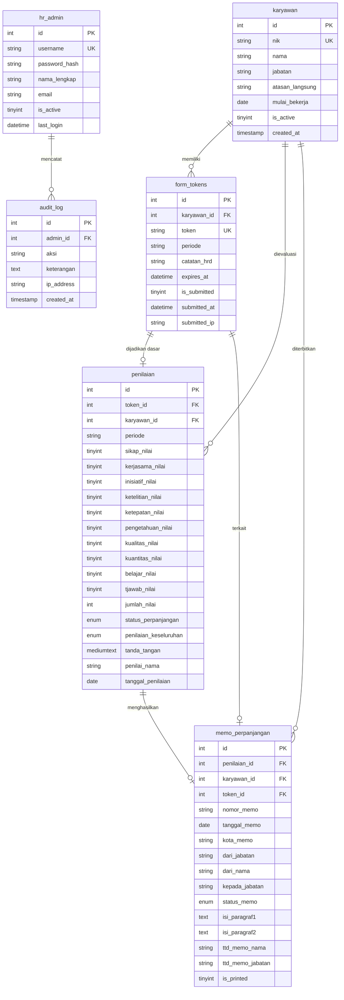

# Sistem Penilaian Kinerja & Memorandum Perpanjangan PKWT
### PT Indopelita Aircraft Industries

Aplikasi web enterprise berbasis PHP Native dan MySQL yang dirancang untuk mengelola siklus evaluasi kinerja karyawan Perjanjian Kerja Waktu Tertentu (PKWT), pembuatan tautan penilaian terproteksi token, kalkulasi predikat otomatis, tanda tangan digital, serta penerbitan dokumen resmi **Memorandum Perpanjangan Kontrak**.

---

## 📑 Daftar Isi

1. [Ringkasan Proyek](#-ringkasan-proyek)
2. [Fitur Utama](#-fitur-utama)
3. [Teknologi yang Digunakan](#-teknologi-yang-digunakan)
4. [Struktur Direktori](#-struktur-direktori)
5. [Skema & Kamus Data Database](#-skema--kamus-data-database)
6. [Panduan Instalasi & Konfigurasi](#-panduan-instalasi--konfigurasi)
7. [Panduan Penggunaan Sistem](#-panduan-penggunaan-sistem)
8. [Dokumentasi Alur Kerja (Flow)](#-dokumentasi-alur-kerja-flow)
9. [Standar Desain & UI/UX](#-standar-desain--uiux)
10. [Keamanan & Audit Trail](#-keamanan--audit-trail)

---

## ✈️ Ringkasan Proyek

Sistem Penilaian Kinerja PKWT ini dikembangkan khusus untuk mendukung divisi **Human Capital / HRD PT Indopelita Aircraft Industries** dalam mengevaluasi efektivitas, kompetensi, dan kedisiplinan personel kontrak di lingkungan industri dirgantara dan layanan rekayasa industri (*Aviation & Industrial Field Services*).

Sistem ini memfasilitasi pengisian formulir evaluasi yang aman dan rahasia oleh atasan langsung melalui **token sekali pakai (one-time secure link)** tanpa mengharuskan atasan memiliki akun sistem. Begitu penilaian diselesaikan, sistem langsung mengkalkulasi kelayakan perpanjangan kontrak dan menghubungkannya dengan formulir penerbitan **Memorandum Resmi Perusahaan**.

---

## 🌟 Fitur Utama

### 1. Modul Evaluasi Publik (Atasan Penilai)
- **Token-Based Access**: Akses instan dan aman via link unik 64-karakter (berlaku 7 hari atau sekali pakai).
- **10 Kriteria Penilaian Berbobot (Skala 1–5)**:
  - Sikap / Attitude
  - Kerjasama / Teamwork
  - Inisiatif & Kreativitas
  - Ketelitian
  - Ketepatan Waktu
  - Pengetahuan Pekerjaan
  - Kualitas Pekerjaan
  - Kuantitas Pekerjaan
  - Kemampuan Belajar
  - Tanggung Jawab
- **Live Calculation**: Predikat dan kalkulasi skor total (maks. 50 poin) terhitung seketika di peramban.
- **Rekomendasi Otomatis**:
  - Skor $\ge 28$: **Diperpanjang**
  - Skor $< 28$: **Tidak Diperpanjang**
- **Digital Signature Pad**: Kanvas tanda tangan digital berbasis HTML5 dengan tombol Undo/Clear yang tersimpan dalam format Base64 PNG terenkripsi.
- **Formulir Kualitatif**: Evaluasi keseluruhan, bidang keunggulan, bidang pengembangan, rencana pelatihan (4 butir), dan deskripsi pekerjaan harian (*jobdesk* A–J).

### 2. Modul Pembuatan Dokumen Memorandum
- **Integrasi Otomatis**: Menarik data karyawan dan skor evaluasi langsung dari hasil penilaian.
- **Sinkronisasi Redaksi Dinamis**: Teks paragraf pembuka dan pengantar tabel nominatif memo tersinkronisasi otomatis saat status perpanjangan dipilih, dan tetap dapat disesuaikan manual.
- **Live Document Preview**: Pratinjau memorandum resmi PT Indopelita secara *real-time* saat pengisian form.
- **Export & Print Ready**: Standar cetak A4 resmi lengkap dengan header memo, nomor dokumen, kualifikasi, tembusan, dan ruang pengesahan tanda tangan.

### 3. Portal Administrasi HRD
- **Executive Analytics Dashboard**:
  - Ringkasan metrik total karyawan aktif, tingkat penyelesaian evaluasi, tren bulanan, rata-rata skor kinerja, dan rasio perpanjangan.
  - Grafik tren 12 bulan dan *heatmap* distribusi skor kompetensi.
- **Manajemen Karyawan**:
  - Pencatatan NIK, nama, jabatan, atasan langsung, dan tanggal mulai bekerja.
  - Fitur Import data karyawan massal via CSV spreadsheet.
- **Manajemen Token Penilaian**:
  - Pembuatan token perorangan dengan periode evaluasi, shift, cuti, dan catatan HRD.
  - Generator pesan siap kirim langsung ke aplikasi **WhatsApp** atasan terkait.
  - Pelacakan status token: Aktif, Kedaluwarsa, atau Sudah Diserahkan (*Submitted*).
- **Manajemen Memorandum**:
  - Repositori seluruh memo yang telah diterbitkan.
  - Cetak ulang dokumen memo kapan saja.
- **Laporan & Export**: Ekspor rekapitulasi evaluasi ke format CSV/Excel dan pratinjau cetak massal (*batch print*).
- **Audit Trail**: Pencatatan riwayat setiap aktivitas admin (login, pembuatan memo, ekspor data, modifikasi akun) beserta alamat IP.
- **Manajemen Admin**: Pengelolaan akses tim HRD, aktivasi/penonaktifan akun, dan reset kata sandi.

---

## 🛠️ Teknologi yang Digunakan

| Komponen | Teknologi | Keterangan |
| :--- | :--- | :--- |
| **Backend** | PHP 8.2+ (Native) | Arsitektur prosedural modular yang ringan, cepat, dan mudah dipelihara. |
| **Database** | MySQL / MariaDB (InnoDB) | *Foreign Keys* relasional dengan *cascade integrity*. |
| **Frontend UI** | HTML5, Vanilla JavaScript | Tidak ada ketergantungan framework JS berat. |
| **Styling & CSS** | Custom Enterprise CSS Tokens | Modern SaaS aesthetic ([app.css](file:///c:/xampp/htdocs/pkwt/assets/css/app.css)) dengan palet warna korporat. |
| **Tipografi** | Google Fonts | `Plus Jakarta Sans` (Heading), `Inter` (UI/Body), `Times New Roman` (Cetak Resmi). |
| **Ikonografi** | Inline SVG Helper | Komponen vektor SVG bersih tanpa library eksternal. |
| **Digital Signature** | HTML5 Canvas API | Tangkapan tanda tangan halus dengan rasio resolusi tinggi (DPR). |
| **PDF Generation** | `html2pdf.js` & Print CSS | Dukungan konversi canvas/HTML ke file PDF A4 langsung di browser. |

---

## 📁 Struktur Direktori

```
c:/xampp/htdocs/pkwt/
├── 404.php                     # Halaman error 404 modern
├── cetak_memo.php              # Template cetak & unduh PDF Memorandum A4
├── config.php                  # Konfigurasi DB, session, konstanta, & helper SVG icon()
├── database.sql                # Skema DDL lengkap dan sample data
├── form.php                    # Formulir penilaian kinerja publik (akses via token)
├── form_memo.php               # Formulir penyusunan memorandum perpanjangan kontrak
├── form_memo_skip.php          # Layar konfirmasi jika memo dilewati untuk dibuat nanti
├── index.php                   # Gerbang redirect (ke Dashboard jika login, Login jika belum)
├── FLOW.md                     # Dokumentasi arsitektur dan diagram alir proses (Dedicated Flow)
├── README.md                   # Dokumentasi utama proyek
│
├── admin/                      # Modul Administrasi HRD
│   ├── admin_mgmt.php          # Pengelolaan akun pengguna HR Admin
│   ├── audit.php               # Riwayat audit log sistem
│   ├── cetak_penilaian.php     # Template cetak A4 lembar penilaian kinerja
│   ├── dashboard.php           # Dashboard statistik analitik & KPI
│   ├── detail_memo.php         # Rincian memo & tombol pembuatan memo
│   ├── detail_penilaian.php    # Rincian penilaian, radar kompetensi, & buat memo
│   ├── edit_karyawan.php       # Edit profil karyawan & riwayat evaluasi
│   ├── hapus_memo.php          # Action handler penghapusan memo
│   ├── hapus_penilaian.php     # Action handler penghapusan penilaian
│   ├── import_karyawan.php     # Unggah data karyawan via CSV
│   ├── karyawan.php            # Master data karyawan
│   ├── laporan.php             # Laporan rekap & ekspor CSV
│   ├── login.php               # Halaman login administrator
│   ├── logout.php              # Action handler keluar dari sesi admin
│   ├── memo.php                # Master data memorandum perpanjangan
│   ├── password.php            # Formulir ubah kata sandi admin
│   ├── penilaian.php           # Master data hasil penilaian karyawan
│   ├── test_sheet.php          # Alat diagnostik integrasi Google Spreadsheet
│   └── token.php               # Pembuatan dan pelacakan token formulir
│
├── assets/                     # Berkas Statis
│   ├── css/
│   │   └── app.css             # Sistem desain korporat & variabel token UI
│   └── img/
│       ├── logo.png            # Logo PT Indopelita
│       └── logo_indopelita.jpg # Logo kop surat resmi
│
└── includes/                   # Parsial & Layout Reusable
    ├── admin_footer.php        # Footer admin & fungsi toast notification
    ├── admin_header.php        # Topbar, sidebar navigasi admin, & SVG helper
    └── logo.php                # Helper render logo responsif
```

---

## 🗄️ Skema & Kamus Data Database

Sistem menggunakan database bernama `pkwt_assessment` yang terdiri dari 6 tabel utama:



---

## 🚀 Panduan Instalasi & Konfigurasi

### 1. Kebutuhan Server
- **Web Server**: Apache (XAMPP / WampServer / Linux LAMP).
- **PHP**: Versi 8.1 atau lebih tinggi (disarankan PHP 8.2).
- **Ekstensi PHP Wajib**: `mysqli`, `curl`, `mbstring`, `session`.
- **Database**: MariaDB 10.4+ atau MySQL 8.0+.

### 2. Langkah Pemasangan di Windows (XAMPP)

1. Letakkan repositori ke direktori root web server XAMPP:
   ```
   C:\xampp\htdocs\pkwt
   ```
2. Jalankan modul **Apache** dan **MySQL** dari XAMPP Control Panel.
3. Buka **phpMyAdmin** (`http://localhost/phpmyadmin`).
4. Buat database baru bernama:
   ```sql
   CREATE DATABASE pkwt_assessment CHARACTER SET utf8mb4 COLLATE utf8mb4_unicode_ci;
   ```
5. Impor skema tabel dari berkas `database.sql`:
   * Buka database `pkwt_assessment` &rarr; tab **Import** &rarr; pilih berkas [database.sql](file:///c:/xampp/htdocs/pkwt/database.sql) &rarr; klik **Go**.
6. Sesuaikan konfigurasi di [config.php](file:///c:/xampp/htdocs/pkwt/config.php) bila kredensial MySQL Anda berbeda:
   ```php
   define('DB_HOST', 'localhost');
   define('DB_NAME', 'pkwt_assessment');
   define('DB_USER', 'root');
   define('DB_PASS', '');

   define('APP_NAME', 'Sistem Penilaian Kinerja PKWT');
   define('APP_URL',  'http://localhost/pkwt'); // Tanpa garis miring di akhir
   ```

---

## 👥 Panduan Penggunaan Sistem

### 1. Kredensial Masuk Administrator
- **URL Login**: `http://localhost/pkwt/admin/login.php`
- **Username Default**: `admin`
- **Password Default**: `admin123`

> [!WARNING]
> Sangat disarankan untuk segera mengubah kata sandi default setelah instalasi pertama melalui menu **Admin > Ganti Password**.

---

### 2. Prosedur Operasional Standar (SOP)

```
[1. Input Karyawan] ──▶ [2. Terbitkan Token] ──▶ [3. Kirim via WhatsApp]
                                                         │
[6. Arsip & Cetak]  ◀── [5. Susun Dokumen Memo] ◀── [4. Atasan Isi Form]
```

1. **Input / Sinkronisasi Karyawan**:
   * Buka menu **Karyawan**. Tambahkan personel PKWT baru atau gunakan **Import CSV**.
2. **Penerbitan Tautan Evaluasi**:
   * Buka menu **Token Penilaian** &rarr; klik **Buat Token Baru**.
   * Pilih nama karyawan, tentukan periode kontrak (contoh: `Januari - Desember 2026`), catatan HRD, cuti, dan shift.
3. **Pengiriman Tautan**:
   * Salin tautan formulir atau klik tombol **Kirim via WhatsApp** untuk membuka template pesan otomatis ke atasan penilai.
4. **Pengisian oleh Atasan**:
   * Atasan membuka tautan di browser, menilai 10 butir faktor kinerja, mengisi catatan kualitatif, membubuhkan tanda tangan digital di layar, dan klik **Kirim Penilaian**.
5. **Pembuatan Memorandum**:
   * Sistem otomatis mengarahkan ke halaman penyusunan **Memorandum Perpanjangan Kontrak**.
   * Lengkapi nomor memo resmi, jabatan penerima/pengirim, tanggal kontrak berikutnya, lalu klik **Simpan & Buat Memo**.
6. **Cetak & Pengarsipan**:
   * Klik tombol **Download PDF** atau **Cetak** untuk menerbitkan dokumen fisik siap tanda tangan basah dan stempel perusahaan.

---

## 🔄 Dokumentasi Alur Kerja (Flow)

Untuk rincian lengkap mengenai diagram alur proses, arsitektur data, transisi *lifecycle* token, rumus kalkulasi skor, serta sequence diagram interaksi sistem, silakan merujuk pada file terpisah:

👉 **[FLOW.md](file:///c:/xampp/htdocs/pkwt/FLOW.md) — Dokumen Khusus Alur & Diagram Sistem PKWT**

---

## 🎨 Standar Desain & UI/UX

Sistem ini menganut standar desain antarmuka korporat modern:
- **Zero AI-Slop**: Tidak menggunakan gradien pelangi mencolok, bentuk *blob* melayang yang tidak perlu, atau emoji berlebihan sebagai ikon sistem.
- **Micro-Dot Indicators**: Status tabel disajikan dengan indikator dot berwarna halus (`.badge-dot`) yang elegan.
- **Tactile Accessibility**: Input form dan tombol memiliki status *focus*, *hover*, dan *active* yang responsif.
- **Document-Desk Contrast**: Halaman formulir publik dan cetak menggunakan latar belakang kanvas gelap modern (`#0b1329`) sehingga dokumen fisik A4 berlatar putih tampil kontras dan representatif layaknya berkas di meja eksekutif.

---

## 🔒 Keamanan & Audit Trail

- **One-Time Form Submissions**: Token yang telah diserahkan otomatis terkunci (`is_submitted = 1`), mencegah manipulasi atau pengisian ulang.
- **Token Expiration**: Token kedaluwarsa otomatis dalam 7 hari sejak tanggal pembuatan.
- **Session Protection**: Sesi admin terlindungi dengan cookie `HttpOnly`, `Strict-Mode`, dan *timeout* otomatis setelah 1 jam inaktivitas.
- **SQL Injection Prevention**: Seluruh kueri interaktif menggunakan *Prepared Statements* (`mysqli_stmt`).
- **Audit Logging**: Setiap aksi krusial dicatat ke tabel `audit_log` lengkap dengan ID Admin, Jenis Aksi, Keterangan, dan Alamat IP.

---

**Hak Cipta &copy; 2026 PT Indopelita Aircraft Industries.**  
*Aircraft Maintenance, Repair, Overhaul & Industrial Field Services.*
